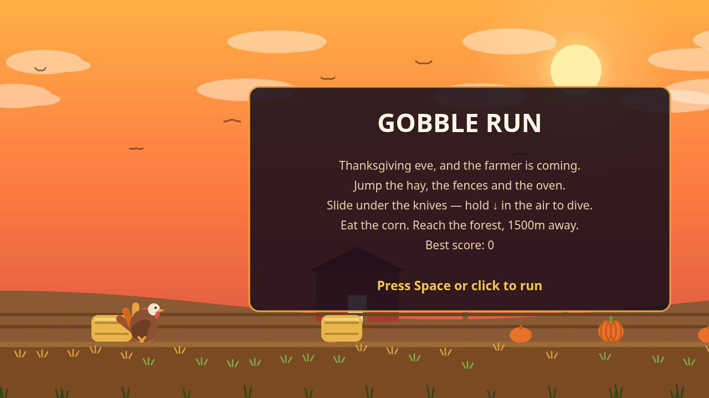
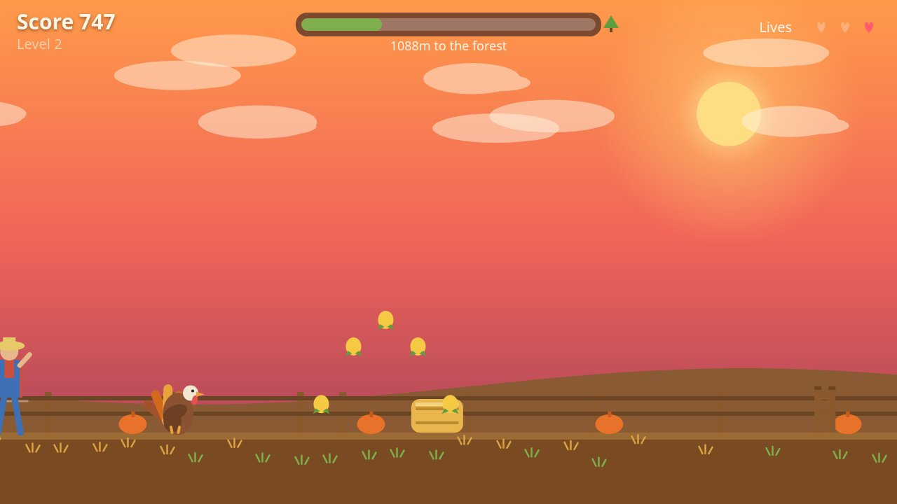
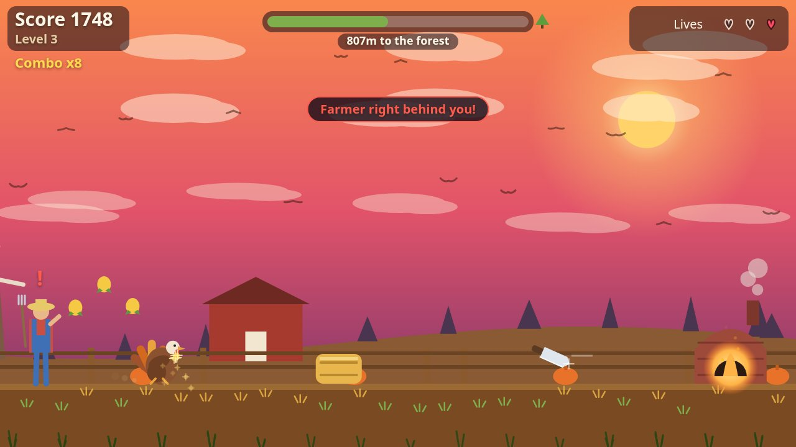
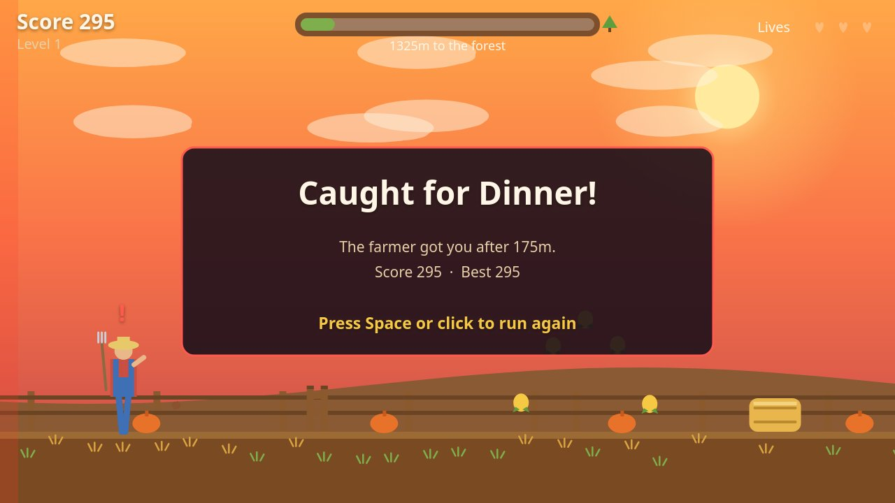

# Gobble Run — The Great Turkey Escape

[](https://make.fun/bounty/turkey-run-game-01)
[](https://make.fun/bounty/turkey-run-game-01)
[](https://make.fun/bounty/turkey-run-game-01)

A side-scrolling escape game made for the [make.fun bounty "Make the best turkey escape game"](https://make.fun/bounty/turkey-run-game-01) (turkey-run-game-01, $250). You are a turkey on Thanksgiving eve. The farmer is coming for you — run 1,500 metres across the farm, jump the hay, the fences and the brick oven, slide under the flying carving knives, eat the corn, and reach the forest before he catches you.

## Play

Open `game/index.html` in a desktop browser (Chrome works best), or serve the folder and visit it:

```sh
node serve.ts --port 8901
# then open http://localhost:8901
```

No build step, no network requests: the game is plain JavaScript and canvas, with synthesised sound effects (WebAudio) and all art drawn in code.

| Key | Action |
| --- | --- |
| Space / ↑ / W / click | Jump (hold for a higher jump) |
| ↓ / S | Slide under the knives — hold it in the air to dive back down |
| P | Pause |
| M | Mute |

Three hearts. Every hit pulls the farmer closer — if he reaches you, it is dinner time. The sky shifts from golden afternoon to sunset to dusk as you get closer to the forest, and a banner marks every 500 m. Your best score is saved in the browser.

## How it is built

- `game/index.html` — the page, the canvas, and the screen-reader announcements.
- `game/src/config.js` — every tuning number and colour in one place.
- `game/src/world.js` — the fixed-step simulation: running, jumping, sliding, diving, the farmer's chase, obstacles, knives, corn, and scoring.
- `game/src/render.js` — all the art: the turkey, the farmer, the barn, the windmill, the oven, the sky, the HUD, and the title / pause / caught / escaped screens.
- `game/src/input.js` — keyboard and pointer input, with jump buffering and coyote time.
- `game/src/sound.js` — synthesised jump / corn / hit / win / caught sounds.
- `game/src/shots.js` — an autopilot that plays the game to stage the screenshots in `screenshots/`.
- `game/src/main.js` — the game loop, the screens, and the `?shot=` staging used for screenshots.
- `main.ts` — builds the submission dossier into `/output` with `vendor/makefun-game.ts`.

## Screenshots

| | |
| --- | --- |
|  |  |
|  |  |

## Development

```sh
node --check game/src/*.js   # syntax-check every game file
node serve.ts --port 8901     # serve the game locally
node shot.mjs ../shots.json screenshots http://localhost:8901  # re-take the screenshots (from the parent folder)
```

## Credits

Made with the [make.fun](https://make.fun) kit. My referral code is `kgdypr8y`. Original art, sounds, and names — no third-party assets.
